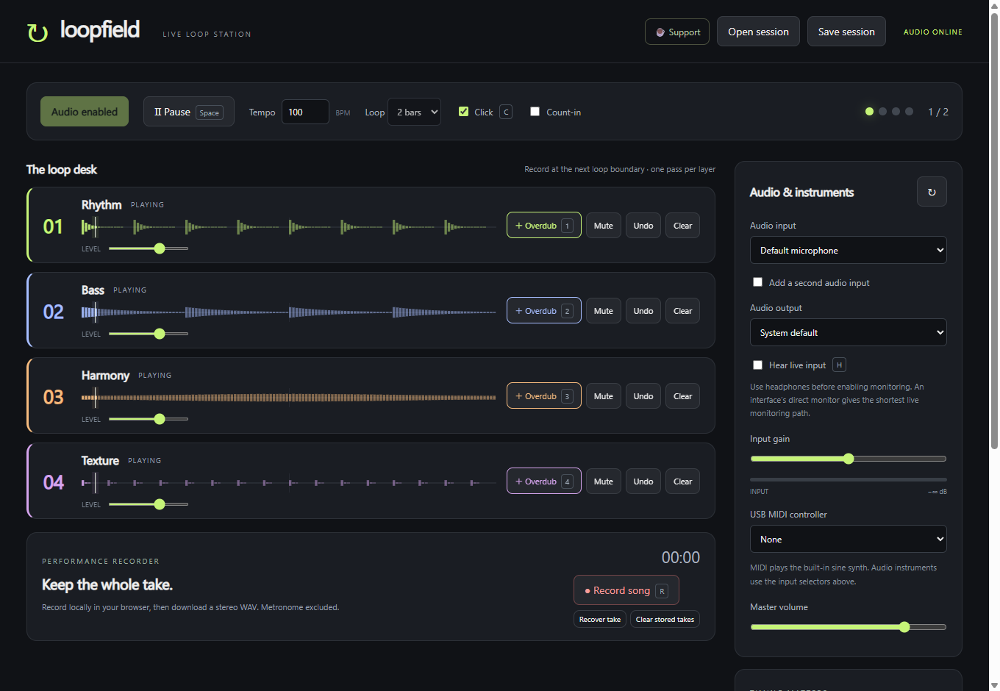

# Loopfield

A minimal, open-source live loop station for microphone, USB audio, MIDI and keyboard input. Four stereo tracks, quantized recording/overdub, undo, count-in, waveforms, editable sessions and performance WAVs.



[Web app](https://davidjongooding.github.io/loopfield/) · [Desktop releases](https://github.com/DavidJonGooding/loopfield/releases) · [Buy me a coffee](https://buymeacoffee.com/davegooding)

**Alpha:** Windows and desktop browsers are the initial test targets. Mac Intel/Apple Silicon packaging is configured in GitHub Actions; actual Mac validation and production signing/notarization remain required. Download links become available when releases are published.

## Your first song

1. Use wired headphones, open the app and click **Enable audio**.
2. Choose your mic or USB audio interface. MIDI uses the MIDI selector and built-in synth.
3. Set tempo and a 1, 2, 4 or 8-bar loop. Press **1** and play after the count-in.
4. Press **2–4** to add parts, or the same track for one overdub pass.
5. Press **R** to record a performance, then finish to save/export a stereo WAV. Save the session to retain editable tracks.

**Space:** play/pause. **Shift + 1–4:** mute. **Alt + 1–4:** undo/redo. **C:** click. **H:** live monitoring. **Esc:** silence synth. **Z X V B N M , .:** synth notes. Use headphones before software monitoring.

## Web app

Use HTTPS or localhost; desktop Chrome/Edge are the first intended browsers. Other browsers may lack MIDI or output-device selection. Audio stays on your device. The coffee link opens separately; no payment scripts, cloud audio upload, accounts or app telemetry are included.

Recording runs in a background worker, using browser-private disk storage when available. Memory fallback is limited to **64 MB PCM**. Finish/download important takes. Browser quotas, private browsing and clearing site data affect recovery. Some storage implementations retain only completed takes after a crash. **Recover take** exports the last available local recording; **Clear stored takes** removes recovery files. Closing a tab can lose recent/uncommitted data.

Static assets are cached for offline visits. Updates wait for a later visit instead of reloading a live take. Sessions export as `.loopfield`; earlier `.loopr` files can still be imported.

## Develop and build

Use Node.js 24:

```sh
npm ci
npm test
npm start
```

```sh
npm run build:web
npm run start:web
# http://127.0.0.1:4173
npm run dist:win
# On macOS:
npm run dist:mac
```

Desktop output: `dist/v<version>`. Web output: `dist/web`. `npm run smoke` and `npm run smoke:web` use synthetic audio/export tests without opening the microphone. See [CONTRIBUTING.md](CONTRIBUTING.md), [release notes](docs/RELEASE_NOTES.md), and [review/roadmap](REVIEW.md).

## Latency and limits

The AudioWorklet engine follows audio frames, independently of UI timers. Interactive latency is requested; browser/OS drivers determine actual buffers. API timing estimates are **not measured round-trip latency**. Manual compensation aligns recordings but cannot reduce monitoring delay.

Prefer wired input/output on one interface and hardware direct monitoring when available. Separate devices can drift. Native ASIO/WASAPI/Core Audio buffer control, automatic calibration, effects, VST hosting, independent track lengths and MIDI clock sync remain future work. Long-run hardware/disk stress tests are still needed.

## Hosting and releases

GitHub Actions builds the website and deploys Pages when configured. Desktop workflows build Windows x64 and experimental Mac x64/arm64 DMG/ZIP packages. Tags create a **draft prerelease** and checksums for review; they do not publish stable downloads automatically.

Set repository Settings → Pages → Source to **GitHub Actions**. Mac public distribution requires Apple signing/notarization and actual microphone/device tests. Default Mac CI uses ad-hoc signing and is not notarized.

## License and support

[MIT](LICENSE). Bundled runtimes retain their own notices: [third-party notices](THIRD_PARTY_NOTICES.md). Optional support helps fund maintenance: [buy Dave a coffee](https://buymeacoffee.com/davegooding).
